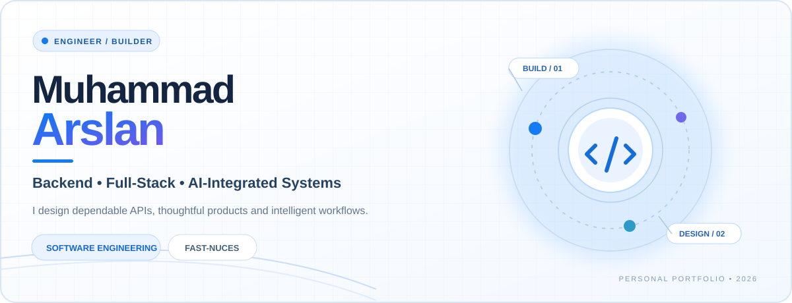
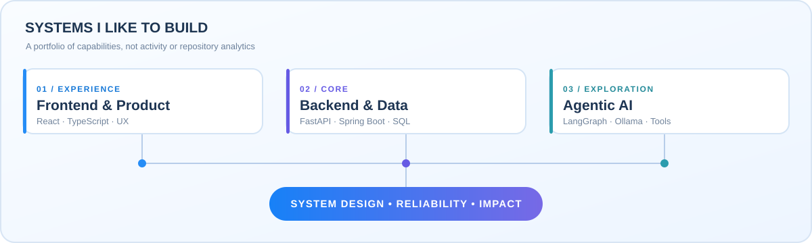
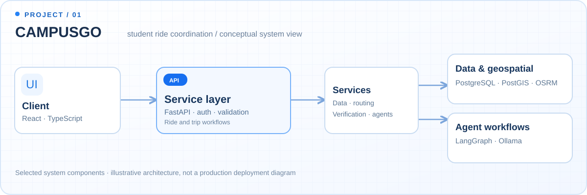
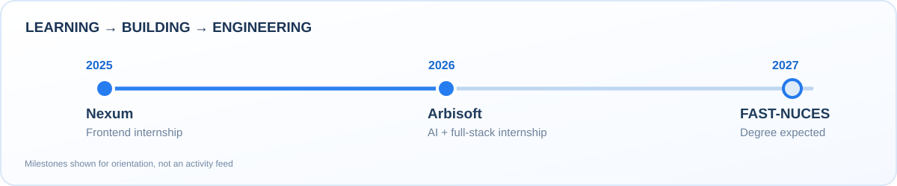

 

[**LinkedIn**](https://www.linkedin.com/in/m-arslan009/) &nbsp;·&nbsp; [**Email**](mailto:iqbalarslan009@gmail.com)

**Design thoughtfully. Build reliably. Keep exploring.**

---

### `01 / THE ENGINEER`

I'm **Muhammad Arslan**, a Software Engineering undergraduate at **FAST-NUCES, Lahore** (expected 2027). My work connects **backend systems**, **full-stack products**, and **practical agentic AI**.

I focus on turning real problems into reliable services, secure data flows, and interfaces people can use. The diagrams below represent **what I build**, not live GitHub data.

### `02 / THE TOOLKIT`

| Focus | Stack and practices |
| :--- | :--- |
| **API & backend** | Python · FastAPI · Java · Spring Boot · Node.js · Express · REST |
| **Interfaces** | React · TypeScript · JavaScript · Tailwind CSS · HTML/CSS |
| **Data systems** | PostgreSQL / PostGIS · MongoDB · SQL Server · Firebase |
| **AI orchestration** | LangGraph · Ollama · prompt engineering · tool-call validation |
| **Engineering quality** | JWT / RBAC · Git · Docker Compose · unit/integration tests · Playwright |

### `03 / FEATURED BUILD — CAMPUSGO`

A **student ride-coordination platform** spanning identity verification, ride and seat workflows, geospatial route matching, and AI-assisted coordination.

**What I engineered:** layered REST APIs with FastAPI, SQLAlchemy, and Pydantic; JWT authentication and Argon2id password hashing; PostGIS/OSRM routing; and guarded LangGraph/Ollama workflows. Added durable notifications, retry/deduplication logic, migrations, and automated testing.

### `04 / MORE SELECTED WORK`

<table>
<tr>
<td width="50%" valign="top">

**EVENTER**  
EVENT MANAGEMENT · MERN

Role-based event workflows with JWT authentication, MongoDB Atlas, and email/SMS notifications.

</td>
<td width="50%" valign="top">

**BOOK LINKER**  
BOOK EXCHANGE · REACT / SPRING BOOT / FIREBASE

Peer-to-peer book lending, donation, and access-controlled exchange workflows.

</td>
</tr>
<tr>
<td valign="top">

**STUDENT MANAGEMENT SYSTEM**  
DESKTOP · .NET / C++

Academic records, attendance, marks, and role-based admin/teacher/student features.

</td>
<td valign="top">

**FAST ELECTRICS**  
DESKTOP · .NET / C++

Electricity-consumption management and device-use scheduling.

</td>
</tr>
</table>

### `05 / THE JOURNEY`

- **Arbisoft · AI-Assisted Web & Agentic AI Intern (Jul–Sep 2026):** Full-stack development, API design, testing, AI-assisted reviews, and the CampusGo project.
- **Nexum · Front-End Developer Intern (Jul–Aug 2025):** React applications, hooks, asynchronous APIs, and component architecture.
- **Recognition:** 3rd place at the **University of Central Punjab Web Hackathon**.

### `06 / HOW I THINK`

> **Understand the problem. Model the system. Validate the edge cases. Keep humans in control of AI-assisted behavior.**

I enjoy thoughtful engineering conversations and opportunities to build useful software.

[**Let's connect on LinkedIn**](https://www.linkedin.com/in/m-arslan009/) &nbsp;·&nbsp; [**Send an email**](mailto:iqbalarslan009@gmail.com)

Static, light-mode portfolio · No live GitHub stats, repository inventory, contribution heatmaps, activity feeds, or automated tracking

