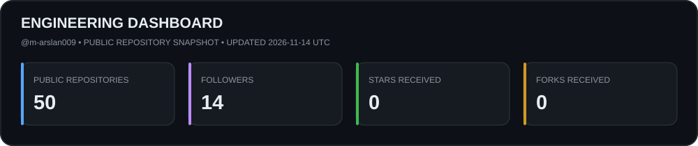
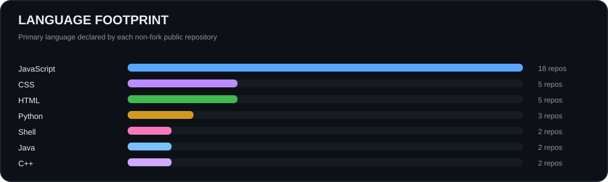
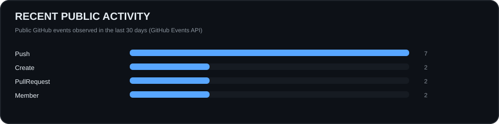

# Muhammad Arslan

### AI-First Software Engineer · Backend & Full-Stack Developer

---

## About

I'm a Software Engineering student at **FAST-NUCES, Lahore**, interested in building software that is useful, maintainable, and thoughtfully engineered.

I enjoy understanding what happens behind the interface: how APIs communicate, how databases preserve consistency, how systems handle concurrent work, and how AI capabilities can make applications more useful.

My current direction is **backend engineering**, supported by full-stack experience and a growing interest in AI-integrated systems.

> I want to understand the engineering principles behind the tools I use — not just learn the tools themselves.

## Engineering dashboard

These cards are generated from GitHub's public REST API by this repository's own GitHub Actions workflow. They are refreshed daily and can also be refreshed manually. Activity reflects public events, not every private or unreported contribution.

## Current engineering focus

| Area | What I'm exploring |
|---|---|
| Backend engineering | Java, Spring Boot, REST APIs, authentication, authorization, service design |
| Database engineering | PostgreSQL, schema design, transactions, indexing, concurrency, consistency |
| Full-stack development | React, Next.js, JavaScript, Node.js, NestJS |
| AI-integrated software | LLMs, AI agents, tool calling, memory, intelligent workflows |
| Systems foundations | Data structures, algorithms, parallel and distributed computing |

## Selected projects

### Atlas OMS — Order Management System
A backend-focused order management project exploring inventory management, relational data integrity, and reliable order processing.

`Java` `Spring Boot` `PostgreSQL` `Docker`

### CampusGO — University Ride-Sharing
A university ride-sharing application connecting students who need rides with students offering them, with map-based route support and AI-powered functionality.

`React` `FastAPI` `MapLibre` `Nominatim` `OSRM`

### LifeTrack Pro — Project & Task Management
A Jira-inspired application for organizing projects, managing tasks, and tracking team progress.

`React` `Django` `SQLite` · [Repository](https://github.com/m-arslan009/Life_Track_Pro)

## Technology toolbox

## Beyond frameworks

<b>Software design & architecture</b>

 
Object-oriented design, SOLID principles, design patterns, clean code, requirements engineering, and maintainable application structure.

<b>Data & concurrency</b>

 
Relational modeling, SQL, transactions, isolation, concurrency control, indexing, and data consistency.

<b>AI and intelligent applications</b>

 
LLM-powered features, agents, tool calling, memory, retrieval, and multi-step workflows.

<b>Computer science foundations</b>

 
Data structures and algorithms, networking, parallel computing, and distributed systems.

## Connect

I'm interested in connecting with engineers and developers, exchanging ideas, and collaborating on meaningful software.

**Understand. Engineer. Improve.**

